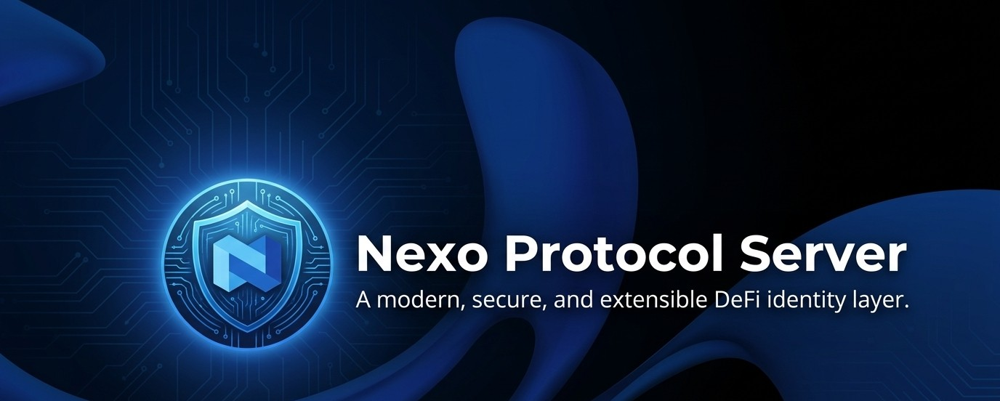
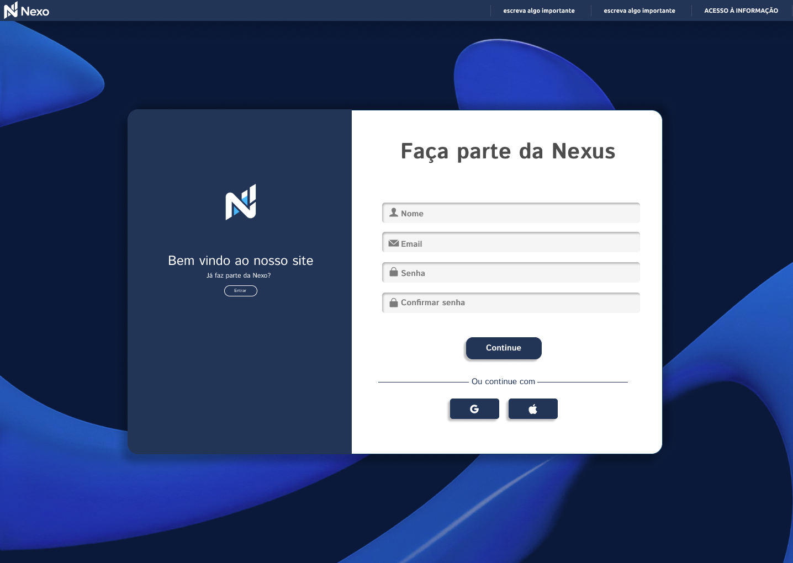
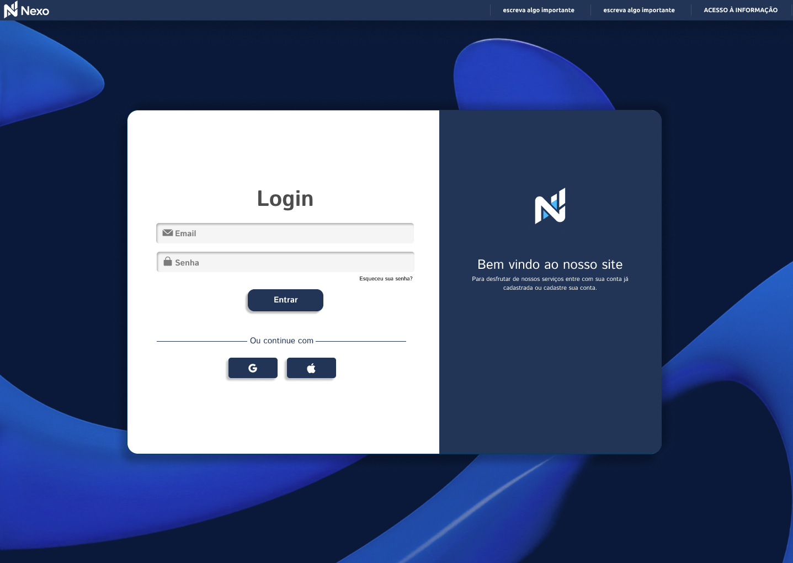
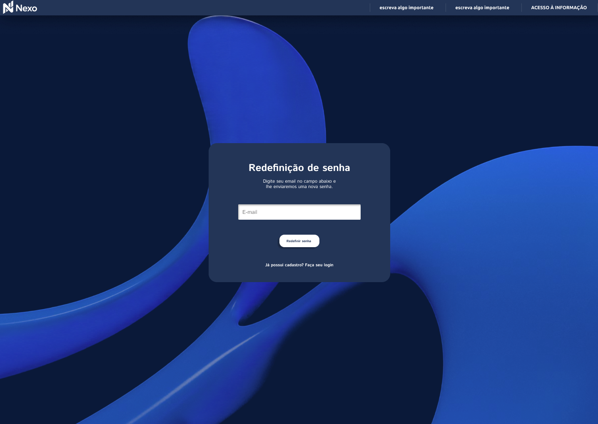
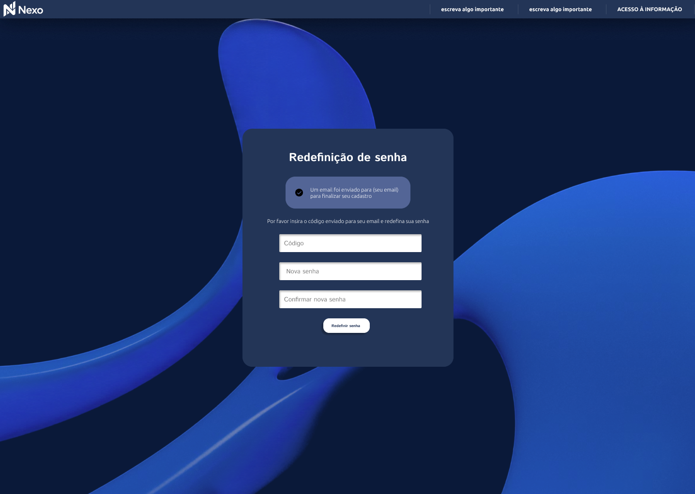

<div id="topo"></div>

<div align="center">
  
</div>

<br>

<div align="center">
  <a href="https://github.com/seu-usuario/projeto-nexo">
    
  </a>
  <a href="https://github.com/seu-usuario/projeto-nexo">
    
  </a>
  <a href="https://github.com/seu-usuario/projeto-nexo">
    
  </a>
  <a href="https://github.com/seu-usuario/projeto-nexo">
    
  </a>
  <a href="https://github.com/seu-usuario/projeto-nexo">
    
  </a>
  <a href="https://github.com/seu-usuario/projeto-nexo">
    
  </a>
  <a href="https://github.com/seu-usuario/projeto-nexo">
    
  </a>
</div>

<br>

<div align="center">
  
  
  
  
  
  
</div>

<div align="center">
  <br>
  <b>Apoie nosso projeto compartilhando:</b><br>
  <br>
  <a href="https://twitter.com/intent/tweet?text=Confira%20o%20Projeto%20Nexo&url=https://github.com/seu-usuario/projeto-nexo">
    
  </a>
  <a href="https://www.linkedin.com/sharing/share-offsite/?url=https://github.com/seu-usuario/projeto-nexo">
    
  </a>
  <a href="https://www.facebook.com/sharer/sharer.php?u=https://github.com/seu-usuario/projeto-nexo">
    
  </a>
  <a href="https://reddit.com/submit?url=https://github.com/seu-usuario/projeto-nexo&title=Projeto%20Nexo">
    
  </a>
  <a href="https://t.me/share/url?url=https://github.com/seu-usuario/projeto-nexo&text=Confira%20o%20Projeto%20Nexo">
    
  </a>
</div>

<br>

<details>
  <summary>Tabela de Conteúdos</summary>
  <ul>
    <li><a href="#visao-geral">Visão Geral</a></li>
    <li><a href="#telas-do-projeto">Telas do Projeto</a></li>
    <li><a href="#tecnologias-e-arquitetura">Tecnologias, Arquitetura e Padrões</a></li>
    <li><a href="#equipe">Equipe</a></li>
    <li><a href="#como-rodar">Como Rodar</a></li>
  </ul>
</details>

---

<h2 id="visao-geral">Visão Geral</h2>

O **Projeto Nexo** é uma plataforma web Full-Stack voltada para **Gestão Financeira Empresarial e Auditoria de Dados em Tempo Real**. O foco principal é aliar alta performance com simplicidade acadêmica, fornecendo uma solução intuitiva para o controle de receitas, despesas, metas mensais, emissão de DRE Gerencial e rastreabilidade completa de operações (logs de quem fez, quando fez e o estado dos dados antes e depois).

> [!IMPORTANT]
> A modelagem relacional do banco (`database/sql/`) organiza os dados nas tabelas centrais: `usuarios`, `perfis_preferencias`, `sessoes_tokens`, `codigos_recuperacao`, `lancamentos`, `metas_financeiras`, `relatorios_exportados`, `audit_logs` e `access_logs`, além de 4 Views Analíticas SQL.


---

<h2 id="telas-do-projeto">Telas do Projeto</h2>

<div align="center">
  
  
  
  
</div>

<br>

O sistema é composto pelas seguintes telas e fluxos principais:

1. **Autenticação (`/`, `/cadastro`, `/redefinir-senha`):** Cadastro com medidor de força de senha, Login com token JWT e Recuperação de Senha em 2 etapas com código de segurança.
2. **Dashboard (`/dashboard`):** Painel de métricas financeiras, variação mensal, metas de faturamento/teto de gastos, gráficos interativos (Fluxo de Caixa 6 meses e Despesas por Categoria) e emissão de DRE Gerencial.
3. **Lançamentos (`/lancamentos`):** Gestão completa de receitas e despesas com filtros combinados, limites e validações de segurança nos formulários (`maxLength` e teto de valor), baixa rápida em 1 clique e exportação CSV.
4. **Logs do Sistema (`/logs`):** Trilha cronológica de auditoria em tempo real restrita a administradores, com filtros por módulo/usuário, comparativo *Antes e Depois* e exportação de planilha Excel (`.csv`).
5. **Perfil e Sobre Nós (`/perfil`, `/sobre`):** Edição de dados cadastrais, troca de senha, configuração multimoeda (`BRL`, `USD`, `EUR`, `GBP`) e apresentação da arquitetura e equipe.


---

<h2 id="tecnologias-e-arquitetura">Tecnologias, Arquitetura e Padrões de Código</h2>

A escolha da stack tecnológica e dos padrões de codificação foi baseada em desempenho, segurança e facilidade de manutenção:

* **Frontend:** React 19 com TypeScript, Vite, Tailwind CSS, Recharts, Radix UI / shadcn e TanStack Router.
* **Backend:** Python com FastAPI, SQLAlchemy 2.0 ORM e Pydantic v2, oferecendo alta performance e documentação interativa nativa via Swagger UI (`/docs`).
* **Banco de Dados:** SQL relacional com suporte automatizado a SQLite (desenvolvimento) e PostgreSQL (produção).

### Padrões de Estilo e Qualidade de Código
* **PEP 8 (Python Style Guide):** Aplicado no Back-End (`snake_case` para funções e variáveis, `PascalCase` para classes ORM e Schemas, `UPPER_CASE` para constantes, indentação de 4 espaços e organização de imports em blocos).
* **Airbnb JavaScript & React Style Guide:** Uso estrito de `const`/`let` (ES6+), Functional Components com Hooks, nomenclatura `PascalCase` para componentes `.tsx` e `camelCase` para funções/hooks, e auto-fechamento de tags sem filhos (`<Component />`).
* **Google HTML/CSS Style Guide:** Indentação de 2 espaços, tags e atributos em letras minúsculas, classes CSS semânticas em `kebab-case` (`.nexo-card`, `.nexo-btn-fluid`), omissão de unidades em valores zero (`0`) e cores hexadecimais abreviadas (`#fff`).


---

<h2 id="equipe">Equipe</h2>

A equipe responsável pelo desenvolvimento e documentação do Projeto Nexo é composta por:

| Nome | Matrícula | Função |
|---|---|---|
| Luann Thayller | 0023194 | Gerente de Projeto, Desenvolvedor Front-End e UI/UX Designer |
| Gabriel Nonato | 0020241 | Desenvolvedor FullStack, Arquiteto Back-End & Engenharia de Dados |
| Weney Anjos da Silva | 0023218 | Desenvolvedor Back-End e Data Engineer |
| Luísa Damaceno | 0016112 | Analista de Requisitos |
| Gabryel Henrique | 0022470 | Assistente Administrativo |
| Érica Beatriz de A. | 0022515 | Analista de Requisitos e UI/UX Designer |


---

<h2 id="como-rodar">Como Rodar</h2>

Siga os passos abaixo para configurar e executar o projeto em seu ambiente local:

```bash
# Opção rápida no Windows (na raiz do projeto):
.\start_all.ps1
# ou execute start_all.bat

# --- Passo a passo manual no terminal ---

# 1. Instale as dependências do backend e inicialize o banco SQL + Seeds
cd backend
pip install -r requirements.txt
python -m app.db.scripts.init_db

# 2. Inicie o servidor do backend (FastAPI + Swagger em http://localhost:8000/docs)
python -m uvicorn app.main:app --reload --host 0.0.0.0 --port 8000

# 3. Em outro terminal, instale as dependências e inicie o servidor do frontend
cd frontend
npm install
npm run dev

# 4. Para inspecionar os logs de auditoria (Quem fez, Hora e O que fez) no terminal:
cd backend
python -m app.db.scripts.inspect_logs
```

<p align="right"><a href="#topo">voltar ao topo</a></p>
